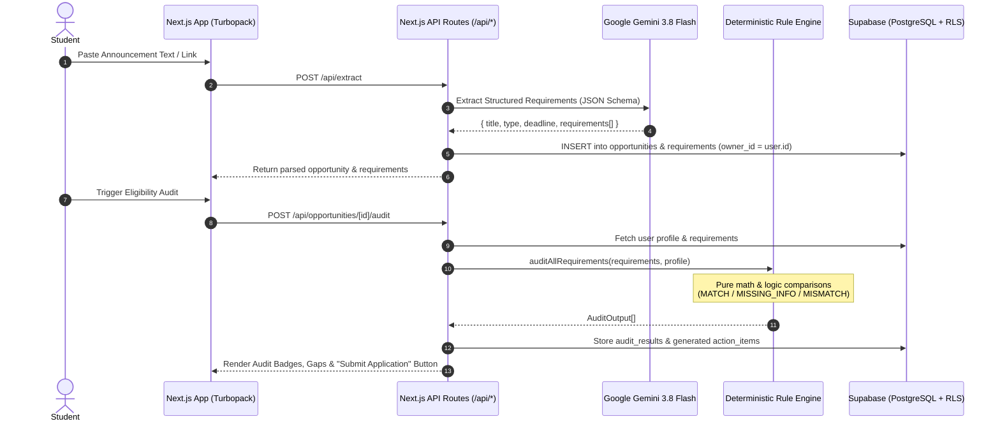

# OpportunityKit 🎓⚡

> **Deterministic eligibility auditing, AI-powered requirement extraction, and deadline-driven action plans for student opportunities.**

[](https://nextjs.org/)
[](https://www.typescriptlang.org/)
[](https://supabase.com/)
[](https://aistudio.google.com/)
[](https://vitest.dev/)
[](LICENSE)

---

## 📌 Overview

**OpportunityKit** solves one of the most frustrating problems students face when applying for internships, scholarships, hackathons, competitions, and research fellowships: **ambiguous, scattered, and dense eligibility criteria**.

Instead of guessing whether you qualify or getting disqualified by hidden cutoffs, OpportunityKit extracts structured requirements from any opportunity circular or URL link and runs a **100% deterministic rule engine** against your profile.

### 🛡️ The Zero-Hallucination Guarantee
Large Language Models (LLMs) are exceptionally proficient at reading messy text, but notoriously unreliable at strict mathematical and logical decisions. OpportunityKit enforces a strict architectural boundary:
- **Gemini 3.8 Flash** extracts structured criteria (category, expected value, operator) into validated JSON schemas.
- **Pure TypeScript Engine** ([`lib/eligibility/engine.ts`](lib/eligibility/engine.ts)) performs all mathematical evaluations, unit normalizations, and comparisons.
- **The AI never decides whether a student is eligible.**

---

## ⚖️ The Three Eligibility Verdicts

Every requirement evaluated by the engine produces exactly one of three deterministic statuses:

| Status | Meaning | Action Taken |
| :--- | :--- | :--- |
| **`MATCH`** | The student's profile fully satisfies the criteria. | Marked green/verified; no action needed. |
| **`MISSING_INFO`** | The student's profile does not have enough information recorded to evaluate this requirement (e.g. unrecorded skill, missing portfolio link, unverified certificate). | **Never treated as an automatic rejection!** Classified as a profile omission or clarification step, prompting the student to update their profile or verify the document before the deadline. |
| **`MISMATCH`** | The student's profile has recorded data that conflicts with a non-negotiable requirement (e.g. graduation year 2027 when 2026 is strictly required, or CGPA below cutoff). | Classified as a hard blocker or time-sensitive gap with an explanation and guidance. |

---

## ✨ Features

- **Multi-Step Profile Wizard** ([`app/(workspace)/app/profile/page.tsx`](app/(workspace)/app/profile/page.tsx)):
  - 5-step guided setup with all 9 mandatory fields marked clearly (`*`).
  - Education breakdown: Separate 10th School & % and 12th College & %, Degree, Branch, CGPA + grading scale, Academic Year.
  - Optional family income field.
  - Geographic preferences (Pan India, Remote, Hyderabad, Bengaluru, etc.).
  - Hackathon & Competition roles (Frontend, Backend, Full Stack, AI/ML, UI/UX, etc.) and team preference.
  - Technical links: Mandatory GitHub profile, optional LinkedIn and Portfolio URLs.
  - **SaaS Profile View Mode**: Read-only overview card once saved, with a 1-click "Edit Profile" toggle.
  - **AI Resume Pre-filling**: Optional text/link resume parser that extracts skills and education into form fields for quick user review.

- **Opportunity Ingestion & URL Scraper** ([`lib/url-scraper.ts`](lib/url-scraper.ts)):
  - Ingest raw announcement text, job postings, or live career links.
  - Built-in SSRF (Server-Side Request Forgery) protection blocking loopback (`127.0.0.1`), private RFC1918 subnets, and metadata endpoints.

- **Deterministic Eligibility Engine** ([`lib/eligibility/engine.ts`](lib/eligibility/engine.ts)):
  - Pure logical operators: `GTE`, `LTE`, `EQ`, `IN`, `ARRAY_INCLUDES`, `ARRAY_CONTAINS_ALL`, `REQUIRED_TRUE`, `DATE_BEFORE`, `DATE_AFTER`.
  - Duration Math: Converts availability months to weeks (e.g., student availability of 6 months satisfies a 4-month internship requirement).
  - Skill Alias Normalization: Handles variations like `React.js` $\leftrightarrow$ `React`, `Node.js` $\leftrightarrow$ `Node`, `Golang` $\leftrightarrow$ `Go`.
  - CGPA Scale Translation: Normalizes 4.0, 7.0, and 10.0 grade scales before comparison.

- **Deadline-Aware Action Plan** ([`lib/eligibility/action-plan.ts`](lib/eligibility/action-plan.ts)):
  - Generates a prioritized, time-ordered checklist based on days remaining until deadline.
  - Direct **"Submit Application"** action button opening the official external job portal (`source_url`).

- **Executive UI & Design System**:
  - Warm ivory (`#FAF9F5`), deep navy (`#16233B`), and soft sage (`#2D5542`) palette.
  - Institutional Trust Bar, 3-step feature preview cards, and Honest Triage visualizer.
  - Fixed non-scrolling workspace sidebar.

- **Campus TPO Proposal View** ([`app/(workspace)/app/campus-tpo/page.tsx`](app/(workspace)/app/campus-tpo/page.tsx)):
  - Institutional dashboard demo tailored for university Training & Placement Offices.

---

## 🏗️ Architecture & Data Flow



---

## 🧰 Tech Stack

- **Framework**: [Next.js 16.4.2](https://nextjs.org/) (App Router, Server Actions, Turbopack)
- **Language**: [TypeScript 5.x](https://www.typescriptlang.org/) (Strict typing, no `any` cheats)
- **Styling**: [Tailwind CSS 3.4](https://tailwindcss.com/) + CSS Variables + Radix UI primitives
- **Database & Auth**: [Supabase](https://supabase.com/) (PostgreSQL 15+, GoTrue Auth, Row-Level Security)
- **AI Extraction**: [Google Gemini 3.8 Flash](https://aistudio.google.com/) via `@google/genai`
- **Validation**: [Zod 3.x](https://zod.dev/)
- **Testing**: [Vitest 5.x](https://vitest.dev/) (60 unit & integration tests)

---

## 📂 Project Structure

```text
opportunitykit/
├── app/
│   ├── (auth)/                  # Supabase authentication flows
│   │   ├── login/               # Sign in with password / magic link
│   │   ├── signup/              # Account creation
│   │   ├── forgot-password/     # Password reset request
│   │   └── auth/callback/       # OAuth & email verification handler
│   ├── (marketing)/             # Public landing page, terms, privacy
│   │   └── page.tsx             # Marketing hero, trust bar, triage visualizer
│   ├── (workspace)/app/         # Protected student dashboard & tools
│   │   ├── analyze/             # Ingestion: URL / text / PDF paste
│   │   ├── opportunities/       # Opportunity library & detail audit view
│   │   ├── profile/             # 5-step profile wizard & view mode
│   │   ├── campus-tpo/          # Campus TPO institutional demo
│   │   └── settings/            # User account settings
│   └── api/                     # Server-side Next.js API endpoints
│       ├── extract/             # Gemini requirement extraction route
│       ├── opportunities/       # CRUD & audit trigger endpoints
│       └── profile/             # Profile upsert & resume parser routes
├── components/
│   ├── brand/                   # Brand logo & iconography
│   ├── shell/                   # Sidebar & Topbar application chrome
│   └── ui/                      # Accessible UI components (Button, Card, Badge, Input)
├── database/
│   ├── migrations/              # Incremental SQL migrations
│   └── supabase_complete_schema.sql # 1-click consolidated schema with RLS & indexes
├── docs/                        # Architecture, file structure, acceptance tests
├── lib/
│   ├── ai/                      # Gemini provider, system prompts, extraction schemas
│   ├── eligibility/             # Deterministic engine, operators, gap classifier, action plan
│   │   └── __tests__/           # Operator and engine unit test suites
│   ├── schemas/                 # Zod validation schemas
│   ├── supabase/                # SSR & Browser Supabase clients
│   └── url-scraper.ts           # SSRF-protected webpage content extractor
├── .env.example                 # Environment variables template
├── middleware.ts                # Route protection middleware
└── vitest.config.mts            # Vitest testing configuration
```

---

## 🚀 Getting Started

### 1. Prerequisites
- **Node.js**: `v20.x` or `v22.x`
- **Package Manager**: `npm`
- **Supabase Account**: A free project at [supabase.com](https://supabase.com)
- **Gemini API Key**: From [Google AI Studio](https://aistudio.google.com/)

### 2. Clone and Install Dependencies

```bash
git clone https://github.com/Kanneboinashivakumar/OpportunityKit.git
cd OpportunityKit
npm install
```

### 3. Configure Environment Variables

Copy the template to `.env.local`:

```bash
cp .env.example .env.local
```

Edit `.env.local` with your credentials:

```dotenv
# Supabase Configuration
NEXT_PUBLIC_SUPABASE_URL=https://your-project.supabase.co
NEXT_PUBLIC_SUPABASE_ANON_KEY=your-anon-key-here

# Google Gemini AI Configuration (Server-side only)
GEMINI_API_KEY=your-gemini-api-key-here
GEMINI_MODEL=gemini-3.8-flash

# Application Base URL
NEXT_PUBLIC_APP_URL=http://localhost:3000

# Optional Limits
MAX_ANNOUNCEMENT_CHARS=30000
EXTRACTION_RATE_LIMIT_PER_HOUR=20
```

> **Security Note:** `GEMINI_API_KEY` is accessed only by server-side routes (`app/api/*`) and is never sent to the client bundle.

### 4. Database Setup

1. Open your Supabase project dashboard.
2. Go to the **SQL Editor**.
3. Copy the entire contents of [`database/supabase_complete_schema.sql`](database/supabase_complete_schema.sql) and click **Run**.
4. In Supabase Dashboard $\rightarrow$ **Authentication** $\rightarrow$ **URL Configuration**, add:
   - Site URL: `http://localhost:3000`
   - Redirect URL: `http://localhost:3000/auth/callback`

### 5. Run Development Server

```bash
npm run dev
```

Open [http://localhost:3000](http://localhost:3000) in your browser.

---

## 🧪 Testing & Verification

OpportunityKit includes comprehensive test coverage for operators, duration math, degree alias tolerance, and URL scraping security:

```bash
# Run Vitest test suite (60 tests)
npm test

# Run TypeScript compiler check
npx tsc --noEmit

# Production build check
npm run build
```

---

## 🔒 Security & Privacy

1. **Row-Level Security (RLS)**:
   Every table in Supabase enforces strict owner-scoped RLS policies. Students can only select, insert, or update their own data (`auth.uid() = owner_id`).
2. **SSRF Guard**:
   [`lib/url-scraper.ts`](lib/url-scraper.ts) validates URL hosts, rejecting private networks (`10.0.0.0/8`, `172.16.0.0/12`, `192.168.0.0/16`, `127.0.0.1`, `localhost`) and AWS/GCP metadata IPs.
3. **Secrets Hygiene**:
   Git tracking strictly ignores `.env*` files, private uploads, resumes, logs, and database dumps via `.gitignore`.

---

## 🤝 Contributing

Contributions are welcome! Please follow these steps:
1. Fork the repository.
2. Create a feature branch (`git checkout -b feature/amazing-feature`).
3. Commit your changes with descriptive messages (`git commit -m 'Add amazing feature'`).
4. Ensure all tests and type checks pass (`npm test && npx tsc --noEmit`).
5. Push to the branch (`git push origin feature/amazing-feature`).
6. Open a Pull Request.

---

## 📄 License

Distributed under the MIT License. See `LICENSE` for more information.
